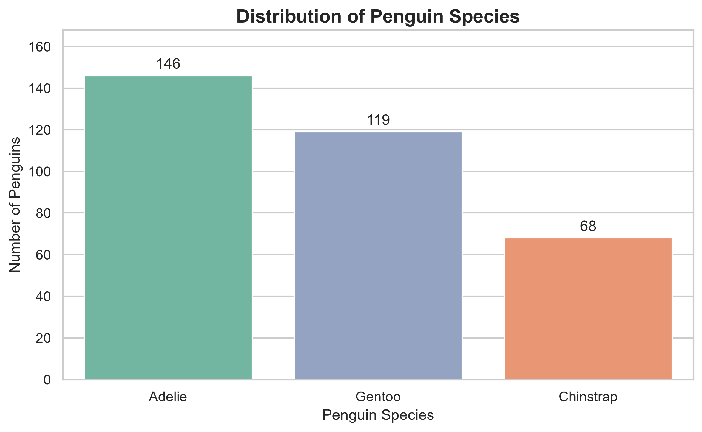
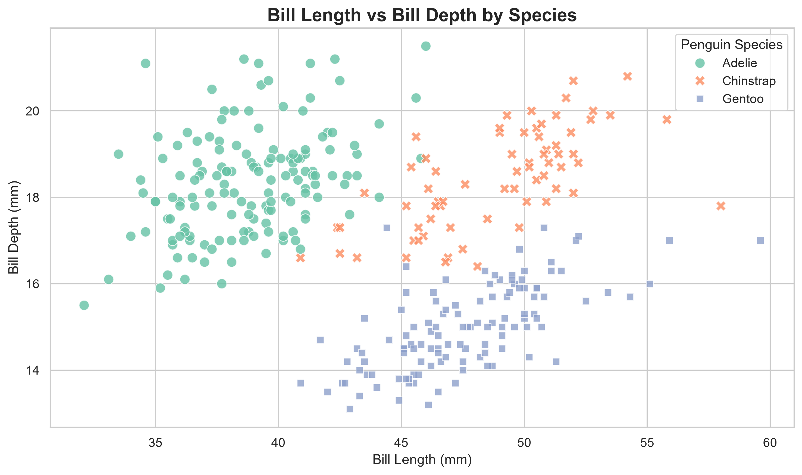
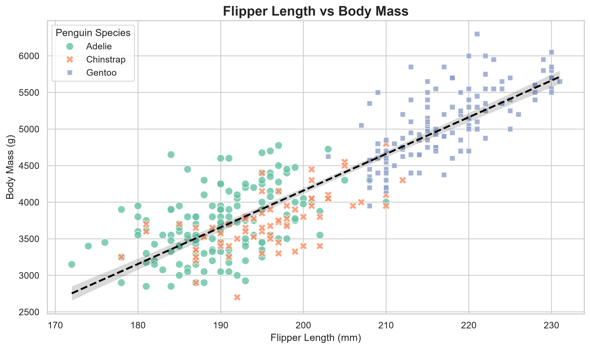
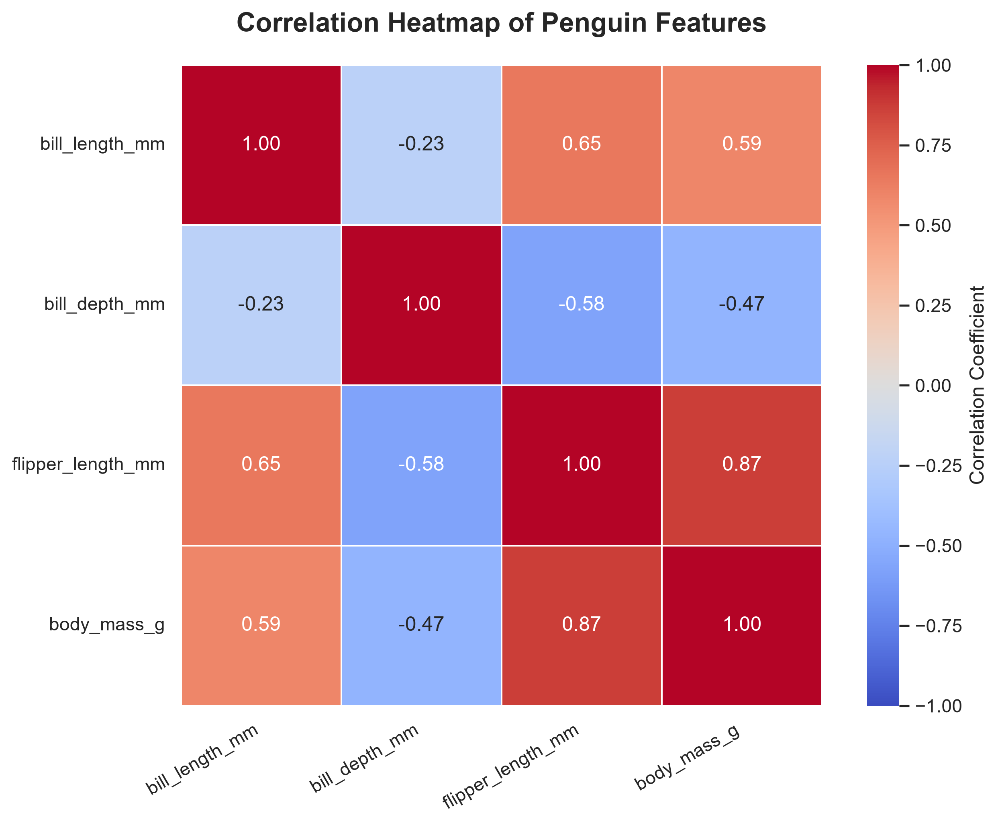
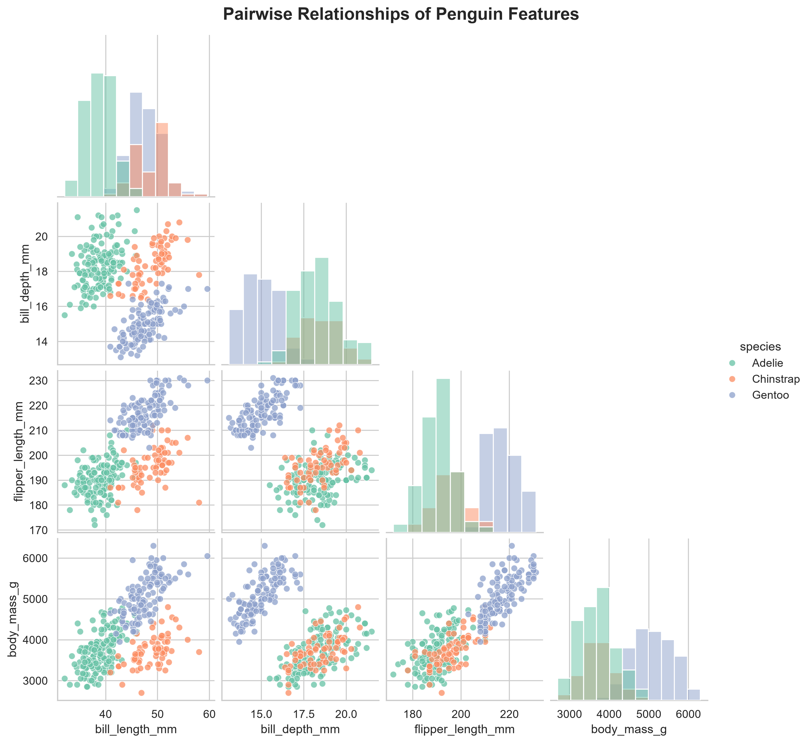
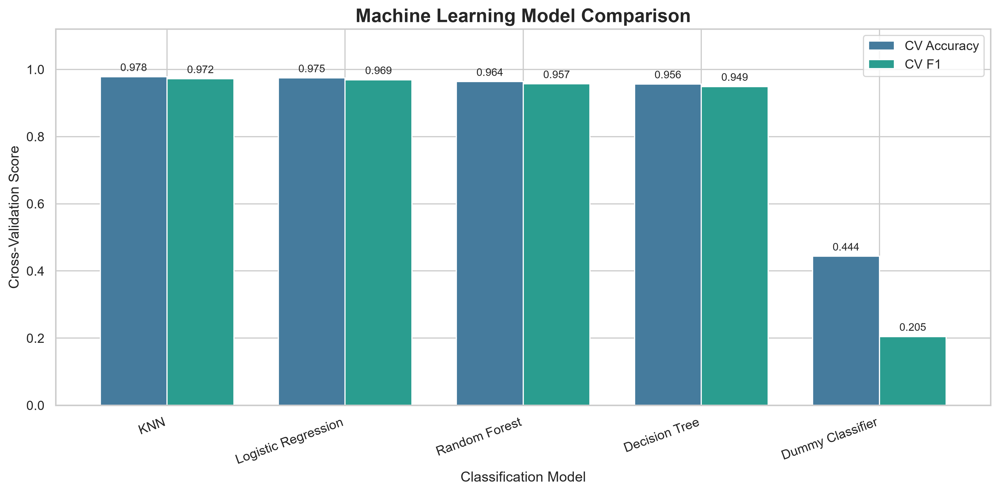
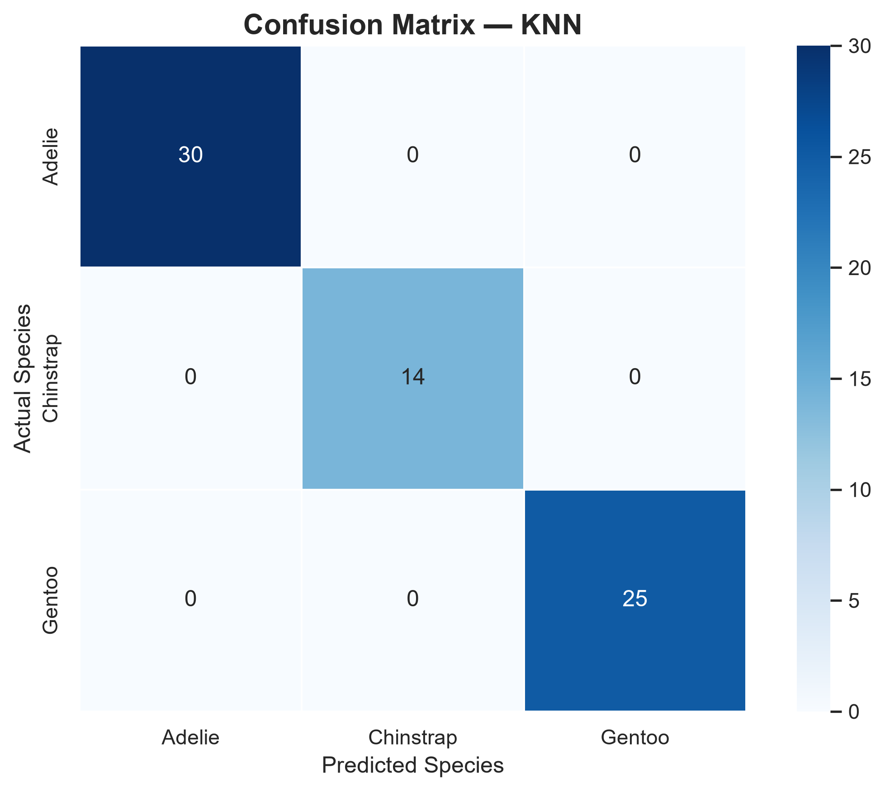
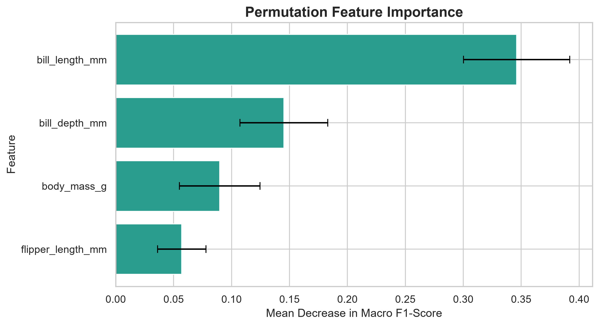

# 🐧 Palmer Penguins — Data Analysis & Species Classification


## 📌 Project Overview

This end-to-end Data Science project explores the Palmer Penguins dataset and develops a supervised machine learning model to classify penguin species based on their physical measurements.

The project covers data collection, data cleaning, exploratory data analysis, statistical analysis, feature selection, machine learning, model evaluation and model persistence.

## 🎯 Project Objectives

- Understand the characteristics of different penguin species.
- Perform comprehensive exploratory data analysis.
- Identify relationships between physical measurements.
- Compare multiple classification algorithms.
- Develop a reproducible species classification pipeline.
- Evaluate and interpret model performance.

## 📊 Dataset Information

The Palmer Penguins dataset contains observations of three penguin species collected from three islands in the Palmer Archipelago, Antarctica.

| Attribute | Details |
|---|---|
| Original observations | 344 |
| Original columns | 7 |
| Cleaned EDA observations | 333 |
| Data retention | 96.80% |
| Selected predictors | 4 |
| Target classes | 3 |

### Penguin Species

- Adelie
- Chinstrap
- Gentoo

### Selected Features

| Feature | Description |
|---|---|
| bill_length_mm | Bill length in millimeters |
| bill_depth_mm | Bill depth in millimeters |
| flipper_length_mm | Flipper length in millimeters |
| body_mass_g | Body mass in grams |

**Target variable:** species

**Dataset source:** [Palmer Penguins](https://allisonhorst.github.io/palmerpenguins/)

**Dataset license:** CC0

## 🛠️ Technologies Used

- Python
- Pandas
- NumPy
- Matplotlib
- Seaborn
- Scikit-learn
- Jupyter Notebook
- Joblib
- VS Code
- Git and GitHub

## 🔄 Project Workflow

1. Data Collection
2. Data Understanding
3. Data Quality Assessment
4. Data Cleaning
5. Descriptive Statistics
6. Univariate Analysis
7. Bivariate Analysis
8. Multivariate Analysis
9. Feature Selection
10. Machine Learning
11. Model Evaluation
12. Model Persistence

## 📈 Exploratory Data Analysis

### Species Distribution



### Bill Length vs Bill Depth



### Flipper Length vs Body Mass



### Correlation Heatmap



### Pairwise Feature Relationships



## 🔍 Key Analytical Findings

- Gentoo penguins have the highest average body mass and flipper length.
- Chinstrap penguins have the highest average bill length.
- Adelie penguins generally have shorter bills.
- Gentoo penguins have comparatively shallow bills.
- Flipper length and body mass exhibit a strong positive correlation of approximately 0.87.
- Combining multiple physical measurements provides useful species separation.
- Bill length was the most important feature according to permutation importance.

## 🤖 Machine Learning

The following classification algorithms were evaluated:

| Algorithm | Purpose |
|---|---|
| Dummy Classifier | Baseline performance |
| Logistic Regression | Linear classification |
| K-Nearest Neighbors | Distance-based classification |
| Decision Tree | Rule-based classification |
| Random Forest | Ensemble classification |

### Preprocessing

- Median imputation
- Feature standardization where required
- Stratified train-test splitting
- Scikit-learn preprocessing pipelines
- Five-fold stratified cross-validation

Macro F1-score was used as the primary model selection metric.

### Model Comparison



## 🏆 Final Model Performance

**Selected Model: K-Nearest Neighbors (KNN)**

| Metric | Result |
|---|---:|
| Training Observations | 275 |
| Testing Observations | 69 |
| Cross-Validation Macro F1 | 97.19% |
| Test Accuracy | 100.00% |
| Test Macro Precision | 100.00% |
| Test Macro Recall | 100.00% |
| Test Macro F1 | 100.00% |
| Correct Predictions | 69 |
| Incorrect Predictions | 0 |

### Confusion Matrix



### Feature Importance



The selected KNN model correctly classified all 69 observations in the held-out test dataset.

Bill length was identified as the most important predictor through permutation importance.

## 📂 Repository Structure


```text
Palmer-Penguins-Data-Science/
│
├── data/
│   ├── penguins.csv
│   └── penguins_cleaned.csv
│
├── models/
│   └── penguin_classifier.joblib
│
├── results/
│   ├── classification_report.csv
│   ├── feature_importance.csv
│   ├── final_model_metrics.csv
│   └── model_comparison.csv
│
├── visuals/
│   └── Analysis and evaluation plots
│
├── penguins_analysis.ipynb
├── README.md
├── requirements.txt
└── .gitignore
```


## 🚀 How to Run the Project

### 1. Clone the repository

```bash
git clone https://github.com/yaminich02-spec/Palmer-Penguins-Data-Science.git
```

### 2. Navigate to the project directory

```bash
cd Palmer-Penguins-Data-Science
```

### 3. Install dependencies

```bash
pip install -r requirements.txt
```

### 4. Launch Jupyter Notebook

```bash
jupyter notebook
```

Open `penguins_analysis.ipynb` and execute all cells.

## ⚠️ Project Limitations

- The dataset contains a relatively small sample size.
- The model is limited to three known penguin species.
- Perfect test accuracy does not guarantee perfect generalization.
- Independent external validation has not been performed.
- Correlated features may influence feature importance estimates.
- Full-dataset exploratory analysis may influence feature selection.

## 🔮 Future Improvements

- Hyperparameter tuning using GridSearchCV.
- Development of a Streamlit prediction application.
- Validation using independently collected observations.
- Comparison with additional classification algorithms.

## 📝 Conclusion

This project demonstrates an end-to-end data science workflow, from raw data exploration to machine learning model development and evaluation.

The selected KNN model achieved a cross-validation Macro F1-score of 97.19% and test accuracy of 100% on the available held-out test dataset.

The results demonstrate the potential of physical measurements for penguin species classification within the studied dataset.

## 🙏 Acknowledgements

Thanks to the Palmer Penguins dataset creators and researchers for making this dataset publicly available.
